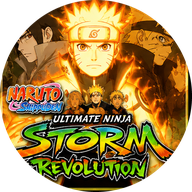

# 🌀 Naruto Shippuden: Ultimate Ninja Storm Revolution — Port Nativo

**O Storm Revolution de Xbox 360 rodando nativamente no Android (ARM64), sem emulador de CPU e com renderizador nativo.**

[Sobre](#-sobre) · [Download](#️-download) · [Recursos](#-o-que-o-port-oferece) · [Requisitos](#-requisitos) · [Versão do jogo](#-versão-do-jogo-obrigatória) · [Controles](#-controles) · [Perguntas](#-perguntas-frequentes)

---

## 📖 Sobre

Este port **não é um emulador de Xbox 360**. O executável do jogo (`default.xex`) é **recompilado estaticamente** de PowerPC para ARM64: o resultado é código nativo, que roda direto no processador do celular.

A parte gráfica usa o **shadowZero**, um renderizador nativo que pega os comandos Direct3D do jogo e desenha direto em Vulkan, sem emular a GPU do Xbox 360.

Este app roda o **Storm Revolution original, sem mods**. O *Storm 4 MOD* tem app e repositório próprios: [naruto-storm-4-mod-port-nativo](https://github.com/Masterllgod/naruto-storm-4-mod-port-nativo). O *Storm Connections* também: [naruto-x-boruto-connections-port-nativo](https://github.com/Masterllgod/naruto-x-boruto-connections-port-nativo).

> [!IMPORTANT]
> **Nada do jogo é distribuído aqui.** Você precisa da sua **própria cópia** de *Naruto Shippuden: Ultimate Ninja Storm Revolution* para Xbox 360, na versão indicada em [Versão do jogo](#-versão-do-jogo-obrigatória).

> [!WARNING]
> **Versão de testes.** O APK está na página de **[Releases](../../releases)**. Ainda pode travar ou ter falhas de imagem; relate nas *Issues* dizendo o aparelho e a resolução usada.

## ✨ O que o port oferece

- Recompilação estática do jogo para **ARM64**, sem interpretador de CPU.
- Renderizador nativo **shadowZero** (Direct3D → Vulkan), com escolha da resolução interna, **FSR** e **Nitidez**, e tela **16:9** ou **esticada**.
- **30 FPS** (ou 20 / 24 para aliviar aparelhos mais fracos) e **modo desempenho**.
- **"Preparando shaders"** antes do jogo começar, para não engasgar na primeira luta.
- **Textos em português** (chave **PT-BR** no menu).
- **Controles na tela** no formato do controle do Xbox, com atalhos de jutsu, jutsu secreto e avanço; editor para mover, redimensionar e ajustar a transparência.
- **Dois controles físicos:** o primeiro é o jogador 1 e o segundo é o jogador 2; em **MAPEAR** dá para trocar os botões de cada um. Plugou um controle, os botões da tela somem.
- **Shadow** pequeno no canto da tela com o menu do jogo: tela 16:9/esticar, mostrar FPS, editar botões, ocultar.
- Menu inicial com o tema do **Pain** (chuva de Amegakure, Rinnegan, nuvens da Akatsuki).
- **Save 100%** embutido, que guarda o seu save e o devolve ao desligar.
- **Atualização automática:** ao abrir o menu, o app avisa quando sai versão nova aqui no GitHub e já baixa e instala.
- **Drivers de GPU customizados (Turnip)** em celulares **Snapdragon**.
- Painel de desempenho (FPS, resolução, CPU, GPU e RAM) e botão de enviar log.

## ⬇️ Download

O APK está na página de **[Releases](../../releases)**.

1. Instale o APK.
2. Copie a pasta do jogo (com o `default.xex`) para o celular.
3. Abra o app, toque no caminho da pasta embaixo do **JOGAR** para escolher a pasta do jogo e dê a permissão de acesso aos arquivos.
4. Toque em **JOGAR**.

A partir da v1.1.2, o app avisa ao abrir o menu quando sai versão nova aqui no GitHub e já baixa e instala.

## 📱 Requisitos

| | Mínimo | Recomendado |
|---|---|---|
| **Android** | 11 (API 30) | 13 ou mais novo |
| **Processador** | ARM64 (arm64-v8a) | Snapdragon 7 Gen 1 / Dimensity 8000 ou superior |
| **GPU** | Vulkan 1.1 com *buffer device address* | Mali-G710 / Adreno 730 ou superior |
| **RAM** | 4 GB | 8 GB ou mais |
| **Espaço** | espaço dos arquivos do jogo | — |

**GPUs que funcionam:** Mali Valhall (G57, G68, G77, G78, G610, G710, G615, G720…), Adreno 6xx com Android 11 ou mais novo, Adreno 7xx e Xclipse. Em GPUs sem *buffer device address* (Mali antigas, Adreno 5xx, PowerVR) o menu mostra **"Celular não suportado"** e o botão de enviar o log.

## 💿 Versão do jogo (obrigatória)

O port é feito para **um executável específico**. O código é recompilado a partir dele, então o `default.xex` precisa ser **idêntico** (confira o hash).

> [!TIP]
> Use o disco **norte-americano (NTSC-U)** cujo `default.xex` tenha o hash abaixo. Disco europeu (PAL) ou japonês não serve.

| Campo | Valor |
|---|---|
| Jogo | Naruto Shippuden: Ultimate Ninja Storm Revolution (Xbox 360) |
| Title ID | `4E4D0868` |
| Media ID | `29E320A9` |
| Versão do executável | `0.0.0.4` |
| Trava de região do executável | somente NTSC-U (América do Norte) |

| Arquivo | Tamanho | SHA-1 | MD5 |
|---|---|---|---|
| `default.xex` | 11.776.000 bytes | `c9c1cf1fc4d7a535542edb1aae19751d4ed7e090` | `a66c3772f0b578c86b3dc7e043a05869` |

<b>Como conferir o hash</b>

- **Windows (PowerShell):** `Get-FileHash default.xex -Algorithm SHA1`
- **Linux / macOS:** `sha1sum default.xex`
- **Android:** qualquer app de "hash checker" da Play Store.

## 🎮 Controles

| Botão na tela | Controle | Ação no jogo |
|---|---|---|
| ATAQUE | B | ataque |
| PULO | A | pulo |
| FERRAMENTA | X | ferramenta ninja |
| CHAKRA | Y | carregar chakra |
| DEFESA | RT | defesa |
| SUBSTITUIÇÃO | LT | substituição |
| APOIO | LB / RB | personagens de apoio |
| DESPERTAR | analógico direito para o lado | despertar (quando a barra permitir) |
| JUTSU / OUGI / AVANÇO | Y B / Y Y B / Y A | atalhos de jutsu, jutsu secreto e avanço |
| SELECT / START | Back / Start | menu e pausa |

O mapeamento de controles físicos pode ser mudado no menu, em **Controle → MAPEAR** (Controle 1 e Controle 2).

## ❓ Perguntas frequentes

<b>Onde baixo?</b>

Na página de **[Releases](../../releases)**. Veja as notas de cada versão.

<b>E o Storm 4 MOD e o Modpack V8?</b>

O Storm 4 MOD agora tem app e repositório próprios: [naruto-storm-4-mod-port-nativo](https://github.com/Masterllgod/naruto-storm-4-mod-port-nativo). As versões antigas (até a v0.13) estão lá.

<b>Funciona com outra versão ou região do disco?</b>

Só se o `default.xex` for **idêntico** (mesmo SHA-1 da tabela). Com hash diferente, não funciona.

<b>O código-fonte está disponível?</b>

Este repositório traz só a documentação. Os componentes de código aberto usados (incluindo os de licença GPL-3.0 do renderizador nativo) estão listados abaixo, com as respectivas licenças.

## 🙏 Créditos

Este projeto só foi possível graças a estes projetos de código aberto:

- [**XenonRecomp**](https://github.com/hedge-dev/XenonRecomp): recompilador estático de PowerPC (Xbox 360)
- [**reNut**](https://github.com/masterspike52/reNut) e os ports [masseffect-nx](https://github.com/nebadasSwifty/masseffect-nx), [nfsmw-nx](https://github.com/StevensND/nfsmw-nx), banjo-nx e sa2-nx: base do renderizador nativo shadowZero
- [**plume**](https://github.com/renderbag/plume) e [**XenosRecomp**](https://github.com/hedge-dev/XenosRecomp): camada Vulkan e tradução dos shaders do Xbox 360
- [**Xenia Canary**](https://github.com/xenia-canary/xenia-canary): referência do hardware do Xbox 360
- [**SDL 3**](https://github.com/libsdl-org/SDL): janela, entrada e áudio
- [**FFmpeg**](https://ffmpeg.org): decodificação de áudio XMA
- [**AMD FidelityFX FSR**](https://github.com/GPUOpen-Effects): escala
- [**libadrenotools**](https://github.com/bylaws/libadrenotools): drivers de GPU customizados no Android

As licenças completas estão em [THIRD_PARTY_NOTICES.md](THIRD_PARTY_NOTICES.md).

## ⚖️ Aviso legal

Este é um projeto de fãs, **sem fins lucrativos**, sem nenhuma ligação com a Bandai Namco, a CyberConnect2, a VIZ Media, Masashi Kishimoto ou a Microsoft. *Naruto* e *Naruto Shippuden: Ultimate Ninja Storm Revolution* são marcas e obras de seus respectivos donos.

Os pacotes **não incluem** arquivos, vídeos, sons ou texturas do jogo: é preciso ter a sua própria cópia original. Não peça nem compartilhe arquivos do jogo nas issues.

---

Feito com 🧡 por <a href="https://www.youtube.com/@Ll_Shadowll">SHADOWll</a>

